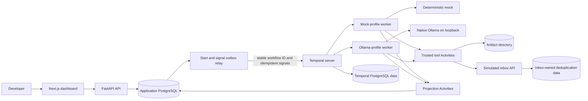

# AgentForge Architecture

## Architectural intent

AgentForge separates durable execution from application presentation:

- **Temporal owns execution history and recovery.**
- **PostgreSQL owns AgentForge records and dashboard projections.**
- **Workers are replaceable processes.** They must not be the only place where
  progress exists.
- **Activities contain side effects.** Workflow code contains deterministic
  coordination only.

## Local component map

## Component responsibilities

### Dashboard

The native Next.js App Router dashboard is a presentation client over PostgreSQL
projections exposed by FastAPI. A same-origin `/backend/*` rewrite targets the
loopback API. It submits one retry-stable UUID key, lists the newest 20 runs,
renders ordered steps and attempts, and exposes exact approval/cancellation
controls and verified artifact text.

Polling is deliberately bounded and sequential: the recent list waits two
seconds after a request settles, while the selected nonterminal detail waits one
second. Selection changes abort the prior request and invalidate its generation,
so an older response cannot replace a newer run. Terminal detail polling stops.
The dashboard never queries Temporal for application state and does not become a
second scheduler.

Artifact metadata comes from the run projection. Content is requested lazily
from the run-scoped API, which rereads the recorded artifact through
`ArtifactStorage`, checks path, media type, size, SHA-256, UTF-8, and length, and
returns sanitized failures. React renders the returned body only as escaped text.
Streaming is deferred.

### API

Accepts retry-safe run submissions, returns a run identifier promptly, exposes
read endpoints, stores approval decisions, and signals Temporal. It does not
wait for an entire run inside one HTTP request.

### Application PostgreSQL data

Stores agent definitions and versions, runs, steps, attempts, approvals,
cancellation requests, accepted delivery receipts, artifact metadata, dashboard
projections, and Workflow start/signal outboxes. It is authoritative for these
application records but does not replace Temporal history.

### Start and signal outbox relay

Bridges committed application intent to Temporal. It starts a stable Workflow
ID and relays approval/cancellation signals from durable outbox rows. A crash
may resend either operation, so starts and Workflow signal handlers are
idempotent. The relay does not schedule steps or decide what the agent should
do.

### Temporal

Owns Workflow history, durable approval timers, Activity retry scheduling,
signal application, and recovery after workers disappear. It coordinates the
run but does not become the approval-record or delivery-record authority.

### Worker

Executes deterministic Workflow coordination and registered Activities. Each
Worker binds one immutable model profile and listens on that profile's task
queue. A mismatch between Workflow input and Worker profile fails closed. A
Worker may be stopped and replaced without losing durable progress.

### Mock model

Returns scripted, schema-valid actions. This keeps the first demonstrations
deterministic, offline, and free of paid credentials. It remains the default
profile and default automated-test path.

### Optional Ollama model

The opt-in `ollama-qwen3-4b-instruct-q4-v1` profile uses native Windows Ollama
over `127.0.0.1:11434`. Startup verifies Ollama version, tag, full digest, and
model metadata before a profile-bound Worker polls its dedicated queue. The
adapter revalidates the tag's full digest immediately before every generation
request, so a tag repointed after Worker startup fails closed. For version 2,
the model supplies bounded researcher notes, writer drafts, and reviewer
decisions. Trusted Activities still choose file reads, storage paths, artifact
publication, approval identity, delivery target, and side effects.

The adapter applies immutable context/output/prompt/report/repair limits. It
rejects oversized responses before parsing, validates a strict schema and exact
goal/path coverage, and permits at most two category-specific repairs. Network
failures are retryable at the Activity boundary; invalid output, configuration,
profile mismatch, and budget exhaustion fail permanently.

### Model profiles and usage

The API exposes only enabled profile descriptors. A complete profile snapshot
is stored with each run, included in its request hash and start-outbox payload,
and copied into Workflow input. Later configuration changes therefore cannot
silently change an existing run's provider, model, digest, queue, or bounds.

Ollama request start/completion evidence is written to the current Activity
attempt. Exact input/output counts and duration come from the provider envelope;
provider charge is zero for the local adapter. A durable exact-input counter
tracks how many requests supplied provider counts. If any request remains
unmeasured or completion is ambiguous, aggregate input stays labeled estimated
and the usage row stays uncertain. Prompts, ticket contents, raw responses, and
hidden reasoning are not persisted as usage evidence.

Integration Workers use the `agentforge-test` Temporal namespace. The local
application uses `default`, preventing test Workers with test database/storage
configuration from polling live application queues.

### Bounded multi-agent report graph

Agent version 2 selects one static Workflow graph, not a generic planner. The
Workflow sorts and partitions at most 16 ticket paths into at most four shards,
schedules researchers in deterministic batches of two, then passes note
references to the writer in shard order. A reviewer may accept or request at
most two revisions. The graph allows at most ten role Activities and 900
seconds before publication. With three Temporal attempts and two provider
repairs per role Activity, the structural worst case is 90 provider requests.

Fixed ordinals reserve read at 0, research at 1–4, writer/reviewer pairs at
5–10, publication at 11, approval at 12, pre-delivery gate at 13, delivery at
14, and post-delivery gate at 15. Role retries stay under one logical step.
Research, draft, and feedback bodies are immutable content-addressed files;
Workflow history contains only verified references and the small review
decision. PostgreSQL remains application-record authority and Temporal remains
execution-history authority.

Version 1 and version 2 Workflow types are registered on each immutable profile
queue. Saved version-1 approved and denied histories replay against the unchanged
version-1 Workflow. Same-queue Worker replicas provide recovery; logical roles
are not separate services. Role Activities heartbeat while provider work is in
flight so a lost Worker is retried by another replica without repeating already
completed research steps.

### Trusted tools

Initially limited to reading approved sample files, atomically saving an
artifact inside the configured directory, and calling the simulated inbox after
approval. Trusted application code—not model text—enforces permissions.

### Simulated inbox

A separate receiver service. It owns its delivery records and applies a unique
constraint to a stable operation identifier. AgentForge must call its API and
must not write directly to its storage.

The receiver validates report media type, byte length, and SHA-256 before it
commits. Replaying the same canonical request returns the original receipt;
reusing an operation ID with changed content returns a conflict.

## Approval and delivery boundary

Trusted Workflow code accepts only the fixed `deliver_report` action and the
fixed `simulated-inbox` target. It compares the action's artifact reference to
the artifact produced by the trusted publication Activity. Canonical JSON of
that exact action produces the SHA-256 action hash; UUIDv5 values derived from
the run and hash identify the approval and external operation.

The API locks the approval row when deciding or expiring it. The Workflow uses
signals only as durable wake-ups and calls a database Activity before delivery,
so a delayed, duplicate, or forged signal cannot overrule PostgreSQL. A
cancellation persisted before delivery prevents the HTTP request. A
cancellation observed after a receiver commit stops later work but does not
claim to undo the receipt.

The delivery Activity verifies artifact bytes immediately before constructing
the HTTP request. It persists the validated receiver receipt in AgentForge
PostgreSQL before returning to Temporal. If a Worker disappears after receiver
commit, the retry uses the same operation ID and the inbox returns the original
receipt.

## Durable identity

- A client submission key identifies a logical submission.
- A run ID identifies one AgentForge execution.
- A stable Temporal Workflow ID is derived from the run ID.
- A step ID identifies one logical step across retry attempts.
- An operation ID identifies one logical external side effect across retries.
- An approval ID and canonical action hash bind a decision to exact arguments.

## Reconciliation

Workflow transitions are projected to PostgreSQL through idempotent Activities.
Each projection event has a stable event ID and sequence number. Reapplying an
event is harmless, and an older sequence cannot overwrite a newer projection.

A repair process may compare nonterminal PostgreSQL rows with Temporal state and
repair stale projections. It never makes Workflow decisions or becomes a second
scheduler.

## Data-placement rules

- Small coordination values and artifact references may appear in Workflow
  history.
- Large report contents remain in the artifact directory.
- PostgreSQL stores artifact path, media type, size, and checksum.
- Secrets never appear in source control, Workflow history, or ordinary logs.
- Approval and delivery records are durable and auditable.
- Report bodies cross only the Activity-to-inbox HTTP boundary; they are not
  Workflow inputs, outputs, or signal payloads.
- Model-profile snapshots and aggregate usage may be stored; prompts, ticket
  bodies, raw model responses, and hidden reasoning may not.

## Exactly-once claim boundary

The verified property is one observable delivery for this simulated receiver
under retries and Worker loss. It depends on durable receiver-side uniqueness
for the stable operation ID and equality checks for the canonical request. It
is not a universal exactly-once guarantee for arbitrary APIs. A destination
without idempotency or a trustworthy reconciliation endpoint can leave an
uncertain result, which AgentForge projects as `NEEDS_ATTENTION` rather than
false success.

The Milestone 8 portfolio reads PostgreSQL, Temporal history, inbox PostgreSQL,
artifact bytes, and operating-system cleanup as separate authorities. Its
component and recovery sequence diagrams are in
[docs/PORTFOLIO_ARCHITECTURE.md](docs/PORTFOLIO_ARCHITECTURE.md); the executable
evidence matrix is in [docs/FAILURE_PORTFOLIO.md](docs/FAILURE_PORTFOLIO.md).

## Future boundaries

Cloud model providers, generic agent graphs, public deployment, shared object
storage, authentication, and production monitoring are later milestones. They
must not weaken immutable routing, privacy boundaries, or recovery behavior.
