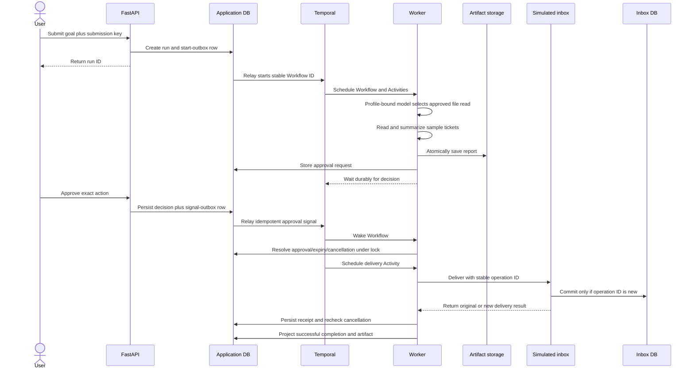
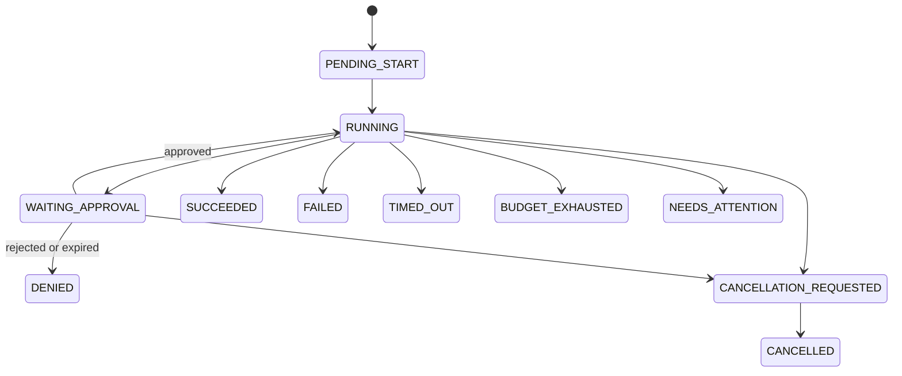
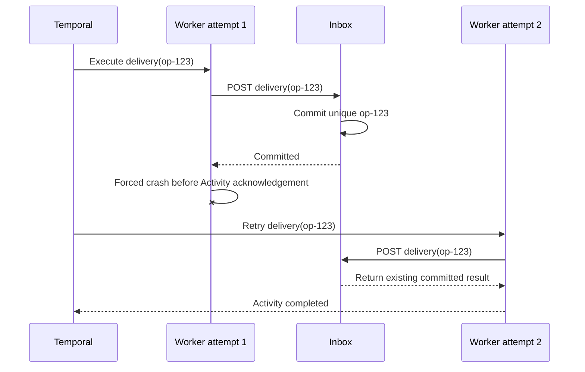

# AgentForge Support-Report Flow

## Normal flow



## Retry-safe submission

1. The client supplies a stable submission key.
2. The API normalizes and hashes the request.
3. One database transaction creates the run and start-outbox record.
4. Reusing the key with the same request returns the existing run.
5. Reusing the key with different content returns a conflict.
6. The relay starts a stable Workflow ID.
7. A crash after Workflow start is recovered by discovering that same Workflow.

## Model selection and local generation

1. The run form defaults to `mock-v1`; the Ollama profile appears only when the
   API process explicitly enables it.
2. Submission resolves the chosen descriptor to a complete immutable snapshot.
   The snapshot participates in the request hash, PostgreSQL run record,
   start-outbox payload, and Temporal Workflow input.
3. Model Activities are scheduled on the snapshot's task queue. The mock and
   Ollama Workers cannot consume each other's model work.
4. Trusted code revalidates the configured Ollama tag against the snapshot's
   full digest, then sends bounded ticket content plus an exact report contract.
   The model cannot choose a new tool, path, target, action hash, or operation
   ID.
5. The adapter accepts one strict JSON report envelope. Schema, nonempty text,
   exact goal/path coverage, and report length are checked. A named semantic
   failure may receive at most two repair requests.
6. Request count, exact provider token counts, duration, model identity, zero
   provider charge, and uncertainty are recorded on the Activity attempt. One
   unmeasured initial or repair request keeps the aggregate estimated and
   uncertain even if a later response includes exact counts.
7. A valid report becomes a draft artifact and then follows the same trusted
   publication, approval, delivery, and deduplication flow as mock mode.

Transport failures are retryable by Temporal. Profile/configuration mismatch,
invalid or repair-exhausted output, and prompt/report budget exhaustion fail
closed. A started request without confirmed provider completion remains visibly
uncertain.

## Version-2 bounded role flow

1. The relay resolves the immutable agent version and starts
   `MultiAgentSupportReportWorkflow` for version 2; version 1 keeps its original
   Workflow type and command sequence.
2. Trusted code reads the approved ticket snapshot once. Sorted paths are
   partitioned into at most four shards and scheduled in batches of at most two.
3. Researchers return immutable note references. Batch completion order cannot
   change the writer's shard-ordered inputs.
4. The writer produces revision 0. The reviewer either accepts it or returns a
   bounded feedback reference. At most revisions 1 and 2 may follow.
5. Cancellation or the 900-second deadline is checked before and after every
   role/batch. An in-flight research batch may settle, but no later role,
   publication, approval, or delivery is scheduled.
6. Only an accepted reviewed draft is published. Reviewer acceptance is not
   delivery permission: the existing exact action-bound human approval and
   pre/post-delivery database gates remain unchanged.
7. Researchers, writer, and reviewer use the run's existing immutable profile
   queue. Multiple Worker processes may poll that same queue; roles are logical
   responsibilities, not independent services or schedulers.

## Browser-guided flow

1. `New run` opens the fixed local support-report form and creates one UUID
   submission key. Network retries reuse that key until success or explicit
   reset.
2. The recent-run rail polls a bounded PostgreSQL projection every two seconds.
   Selecting a run starts a sequential one-second detail poll.
3. Steps and nested attempts render in projection order. A stale nonterminal
   `updated_at` produces neutral `Projection may be delayed` copy; it does not
   imply execution failure.
4. A pending approval shows the exact target, action hash, and artifact metadata.
   Approve/Reject/Cancel share one mutation lock. A successful mutation or `409`
   conflict is followed by an authoritative detail refresh rather than optimistic
   state.
5. Cancellation first warns that already committed delivery cannot be undone.
6. `Report content` lazily requests the run-scoped verified artifact. The browser
   caches that response only for the displayed artifact reference and renders it
   as literal plain text.
7. If a selected run disappears, the dashboard clears it, refreshes the recent
   list, and reports that the run is no longer available.

## Run states



Terminal run outcomes are `SUCCEEDED`, `FAILED`, `DENIED`, `CANCELLED`,
`TIMED_OUT`, `BUDGET_EXHAUSTED`, and `NEEDS_ATTENTION`.

## Approval resolution

1. Trusted code accepts only a report delivery to `simulated-inbox` whose
   artifact reference exactly matches the published artifact.
2. Canonical action JSON determines the action hash, approval ID, and operation
   ID; model output cannot choose these identifiers or the configured URL.
3. The approval Activity stores the exact action and an expiry timestamp, then
   the Workflow projects `WAITING_APPROVAL` and waits on a durable timer or
   signal.
4. The API decides the approval under a row lock and atomically writes a signal
   outbox row. Repeated identical decisions are harmless; conflicts preserve
   the first decision.
5. Duplicate signals are harmless, wrong approval IDs or action hashes are
   ignored, and the Workflow always asks PostgreSQL for the winning stored
   state before delivery.
6. Rejection or expiry produces `DENIED`. A cancellation already stored before
   delivery produces `CANCELLED` without an inbox call.

If cancellation is persisted after the inbox commits, AgentForge keeps the
accepted receipt and projects `CANCELLED`; cancellation stops future work but
does not reverse an external side effect.

## Step states

```text
PENDING -> RUNNING
RUNNING -> SUCCEEDED | WAITING_APPROVAL | RETRY_SCHEDULED
RUNNING -> FAILED | CANCELLED | UNCERTAIN
RETRY_SCHEDULED -> RUNNING
WAITING_APPROVAL -> PENDING | DENIED | CANCELLED
```

Attempts are separate records. Retrying an Activity does not create a new
logical step or a new side-effect operation ID.

## Crash-after-commit flow



Exactly one observable delivery is guaranteed only because this receiver
supports durable deduplication. A destination without idempotency or reliable
reconciliation may produce an uncertain outcome instead.

For retryable transport failures, Temporal makes at most three delivery
attempts under the current policy. If no result can be reconciled, the delivery
step becomes `UNCERTAIN` and the run becomes `NEEDS_ATTENTION`; AgentForge does
not report success merely because the caller lost the response.

The continuous Milestone 8 sequence combines review retry, durable pending
approval across API reconstruction, and post-receiver-commit delivery retry in
one run. See [docs/FAILURE_PORTFOLIO.md](docs/FAILURE_PORTFOLIO.md) for its 20
asserted checkpoints and [docs/PORTFOLIO_ARCHITECTURE.md](docs/PORTFOLIO_ARCHITECTURE.md)
for the cross-authority sequence.
