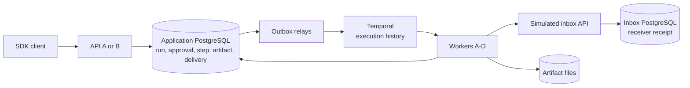
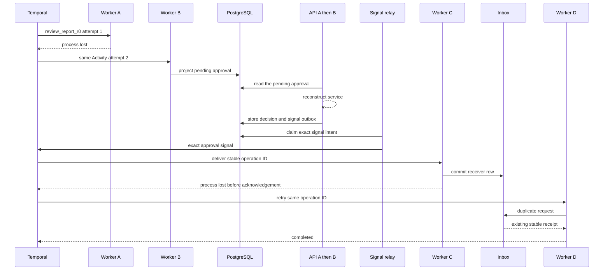

# Portfolio Architecture

The portfolio reads each durable fact from the component that owns it. Logs are
diagnostics, not an extra authority or scheduler.

PostgreSQL is authoritative for application records and projections. Temporal
is authoritative for Workflow execution, timers, Activity attempts, and
replay. Inbox PostgreSQL is authoritative for the receiver-visible side effect.
Artifact files hold report bytes; PostgreSQL stores their relative path, size,
media type, and SHA-256.

## Identity, replay, and bounds

Stable run, Workflow, approval, action-hash, and operation IDs connect the
authorities across service and Worker reconstruction. Temporal replay restores
Workflow control state; Activities perform model, database, file, and network
I/O. A retried logical step keeps its identity while attempt records increase.
The inbox's unique operation ID and canonical-request equality provide receiver
deduplication after an ambiguous commit.

Version 2 has fixed researcher, writer, and reviewer roles, at most four
research shards, bounded research batches, at most two revisions, at most ten
role executions, and a graph deadline. Ordinary unrecoverable work becomes
`FAILED`; revision or graph bounds become `BUDGET_EXHAUSTED`; an unreconciled
external side effect becomes `NEEDS_ATTENTION` with an `UNCERTAIN` step.

## Claim boundary

The portfolio proves recovery against the pinned local stack and the simulated
inbox. It does not prove:

- exactly-once behavior for an arbitrary external API;
- multi-host disaster recovery;
- production authentication, authorization, or security hardening;
- production load capacity or performance targets;
- real-model correctness or report quality.

These exclusions are deliberate: receiver deduplication, deployment topology,
security controls, capacity, and semantic quality require separate evidence.
