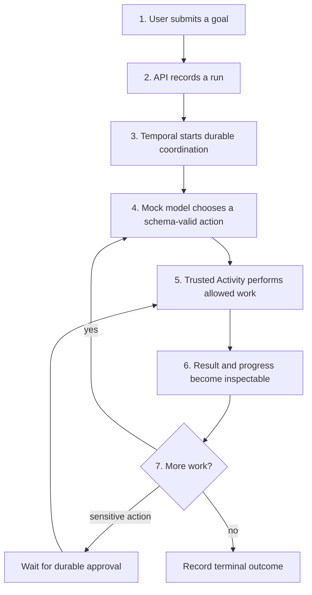
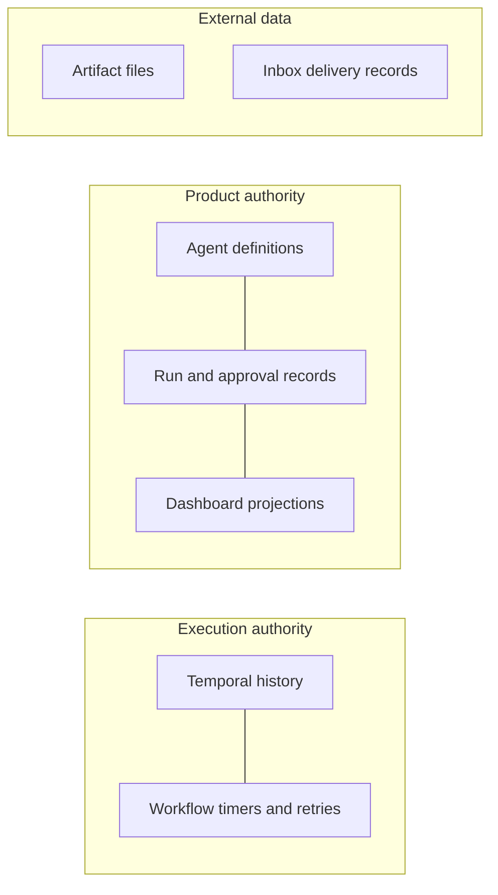
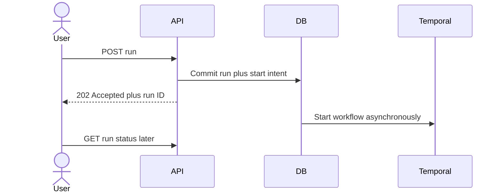
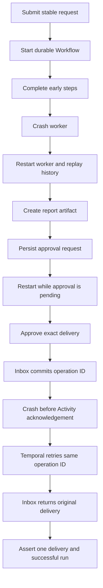

# AgentForge System Workflow

Everything in this document is planned until its milestone is marked complete
in `PROJECT_PLAN.md`.

## The high-level idea



## Who owns what?



Temporal answers “what execution happened and what should be scheduled next?”
PostgreSQL answers “what AgentForge objects should the product display and
query?” Artifact and inbox storage retain their own data.

## Why the API returns early



Keeping one HTTP request open for an entire agent run is fragile. Returning a
run ID lets the client disconnect and come back while the durable Workflow
continues independently.

## Why a stable operation ID matters

Suppose the inbox commits a delivery, but the worker crashes before telling
Temporal that the Activity finished. Temporal cannot know whether the call
committed, so it retries. The second attempt must use the same operation ID.
The inbox sees the existing ID and returns the original result.

```text
Logical operation: deliver report R to simulated inbox
Operation ID:      delivery/<run-id>/<report-hash>
Physical attempts: attempt 1, attempt 2, ...
Observable result: one inbox delivery
```

## Approval boundary

Approval is not “the user generally trusts the agent.” It is permission for a
specific proposal:

```text
agent version + run + tool + normalized arguments + artifact hash + operation ID
```

If any of these changes, the earlier approval cannot be reused.

## Full planned recovery demonstration



Logs help explain this demonstration, but database and receiver assertions are
the proof.
