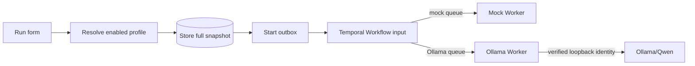

# Milestone 5: An Optional Local Model Without Losing Control

Milestone 5 adds a real model path while preserving the durable and safety
properties built earlier. The default is still a deterministic mock. A run uses
local Qwen only when the API exposes that profile, the user selects it, and a
Worker bound to its dedicated queue is running.

## The central idea: bind identity before execution

A model name alone is not enough. The same tag could point to different bytes,
and an environment variable could change between a retry and a replay.
AgentForge therefore resolves a selection to a full snapshot containing:

- profile ID, provider, model name, and full digest;
- dedicated Temporal task queue;
- context/output token limits;
- serialized prompt and report character limits; and
- maximum semantic repairs.

That snapshot is part of the submission hash, PostgreSQL run, start outbox, and
Temporal input. The Worker compares it with its own profile before calling the
provider. The adapter also resolves the mutable Ollama tag immediately before
every generation request and requires the same full digest. Existing runs
cannot silently drift when configuration or tag targets change.

## What the model may do

Qwen receives the approved goal and ticket snapshot and returns one strict JSON
object containing report Markdown. It does not choose file paths, tools,
approval IDs, targets, or delivery operation IDs. Trusted Python checks that
the report is nonempty, within 16,384 characters, and contains the exact goal
and every ticket path.

Malformed schema or semantic output can trigger a category-specific repair,
but there are at most two repairs after the first request. The 24,000-character
prompt bound, 2,048-token output bound, 131,072-byte response bound, and
150-second read timeout stop unbounded local generation. Provider transport
failures are retryable; invalid output, profile/configuration mismatch, and
budget exhaustion fail closed.

## Usage evidence is not model content

For every Ollama request, AgentForge records model identity, request count,
input/output token counts, duration, zero provider charge, and whether the
evidence is uncertain. A request that starts but never confirms completion is
not displayed as complete usage. Exactness is aggregated across all initial and
repair calls, so a later complete response cannot hide an earlier unmeasured
request.

Prompts, ticket bodies, raw responses, and hidden reasoning are deliberately
excluded from the usage record, Temporal inputs/results, and ordinary logs.
The report body remains in the artifact directory and crosses the network only
inside the approved delivery Activity.

`$0.000000` means there is no provider invoice for local Ollama. It does not
mean the machine, GPU, electricity, cooling, or operator time are free.

## Native proof and process ownership

The verified runtime is Ollama `0.40.11`; the archive hash is
`bda4a493ba8a7c24d57263cd843cd68cee84f44aed4299eeed532acad7eda12a`.
The model is `qwen3:4b-instruct-2507-q4_K_M` with digest
`0edcdef34593eac1aa2be9c7d06c432dcf81945adca5eca2f27662c18f168ba0`.

The harness installs runtime/model data outside the repository. Before reuse it
requires loopback binding plus exact version and digest. When it starts Ollama,
it records process ID, start time, and executable path; cleanup rechecks that
identity so PID reuse cannot stop an unrelated process. Downloads, provider
response reads, model pulls, readiness, smoke generation, and shutdown all have
deadlines.

The real browser proof selects the Ollama profile, waits at the existing exact
approval boundary, approves the displayed action, and verifies one delivery.
It checks durable usage, provider identity, report coverage, zero charge, and
one-to-three requests. It scans PostgreSQL, raw and decoded Temporal payloads,
and process logs for ticket/report probes. Screenshots and traces are disabled
for this private-content journey. Safe failure logs may be retained for
diagnosis; unsafe or unscannable logs are deleted and removal is verified.

## What remains deliberately separate

The real-model proof is opt-in because model quality is nondeterministic and the
download is large. Ordinary unit, integration, migration, and browser tests use
the mock profile. Cloud providers, arbitrary models, multiple agent roles,
deployment, authentication, and provider billing remain later work.
