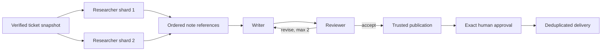

# Milestone 6: A Bounded Multi-Agent Graph

Milestone 6 changes the support-report example from one model decision loop to
three logical roles: researchers gather evidence, a writer assembles the report,
and a reviewer either accepts it or requests a bounded revision. These roles do
not become separate services. Replaceable Worker processes poll the same
immutable model-profile queue, while one Temporal Workflow coordinates a fixed
version-2 graph.

## Why the graph is static

A generic planner would make recovery, limits, and replay harder to prove. The
support-report graph instead reserves every possible step in advance:

```text
0      read tickets
1-4    research shards
5/6    writer/reviewer, initial draft
7/8    writer/reviewer, revision 1
9/10   writer/reviewer, revision 2
11     publish accepted report
12-15  approval, delivery gates, and delivery
```

The graph accepts at most 16 tickets, creates at most four research shards,
runs at most two researchers concurrently, permits two revisions, schedules at
most ten role Activities, and allows 900 seconds before publication. Combining
ten roles, three Temporal attempts, and one initial plus two repair requests
gives a structural ceiling of 90 provider requests.

## Durable data stays small

Researchers, writers, and reviewers handle private ticket-derived text only
inside Activities. Their note, draft, and feedback bodies are written as
immutable content-addressed files. Temporal receives references containing a
relative path, checksum, and size; PostgreSQL stores execution records and
artifact metadata rather than private intermediate bodies.



Research completion order cannot change writer input order. A stale Activity
attempt cannot replace bytes already referenced by durable history. Cancellation
and the graph deadline are checked around every batch and role. If cancellation
arrives during a research batch, only that batch settles; no writer,
publication, approval, or delivery is scheduled afterward.

## Logical roles are not Worker identities

Any compatible Worker on the profile queue may execute any role Activity. Role
Activities heartbeat during provider work. In the recovery proof, one Worker is
terminated during the first review attempt, a replacement Worker completes
attempt 2 under the same logical step, and both completed research shards remain
single-attempt. Temporal owns this execution recovery; PostgreSQL remains the
authority for run, attempt, approval, and delivery records.

## Review is not permission

The reviewer checks report quality only. Even an accepted report cannot be
delivered until trusted code publishes the exact artifact, derives the canonical
action hash and stable operation ID, and receives the existing human approval.
PostgreSQL is reread immediately before delivery. The simulated inbox still
deduplicates the stable operation ID, which is why the project can claim one
observable delivery for that receiver under retries—not universal exactly-once
behavior.

## Replay and native evidence

Version 1 keeps its original Workflow type and command sequence. Saved approved
and denied histories replay against it after version 2 is registered. The
deterministic suite covers partitioning, order, revision and role budgets,
deadline, cancellation, recovery, privacy, and delivery. The opt-in pinned Qwen
journey also completed two researcher calls, a writer call, and a reviewer call,
then reached exact approval and one delivery while keeping intermediate content
out of PostgreSQL, decoded history, logs, screenshots, and traces.
