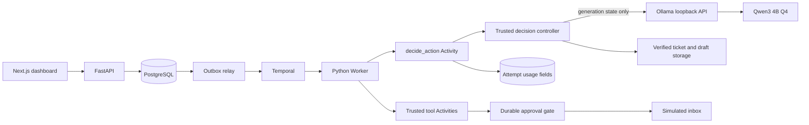

# AgentForge Milestone 5 Local Model Design

Date: 2026-10-25
Status: Approved on 2026-10-25

## Intent

Add one explicitly enabled real-model path to the existing durable support-report
workflow without weakening its deterministic tests, trusted action boundaries,
or local-first operating model. The selected path runs a small quantized Qwen
model through a pinned native Windows Ollama runtime. It demonstrates real model
generation, structured-output validation, bounded repair, token accounting, and
honest uncertainty on the machine already used for Milestones 1–4.

The user is learning how a durable agent works. The milestone therefore favors a
visible, inspectable local setup over the highest possible model quality. The
mock model remains the default and remains the only model used by the ordinary
automated suite.

## Approved direction

Use native Ollama with `qwen3:4b-instruct-2507-q4_K_M`. Model output is limited
to the report body. Trusted Python code continues to choose and validate every
workflow action, file reference, approval target, and external side effect.

Observed target hardware:

- Windows machine with 32 GB system RAM;
- NVIDIA GeForce GTX 1650 with 4 GB VRAM;
- NVIDIA driver 610.88, above Ollama's documented 551.61 minimum;
- Docker Desktop remains reserved for PostgreSQL and Temporal.

The selected Q4 model is approximately 2.5 GB. An 8,192-token context and one
loaded model keep the experiment proportionate to the machine. This is a fit
decision, not a claim that all runtime memory fits entirely in VRAM.

## Goals

- Select an immutable deterministic-mock or local-Ollama profile per run.
- Keep mock mode credential-free, offline, fast, and deterministic by default.
- Generate only a bounded report body from the approved ticket snapshot.
- Enforce a strict JSON schema and trusted semantic checks on every response.
- Allow at most two repair calls after the initial generation call.
- Record model identity, request count, tokens, latency, provider-cost estimate,
  and uncertainty without storing prompts, raw responses, or hidden reasoning.
- Show model usage on the existing run timeline without creating a competing
  source of execution state.
- Prove one real local-model run through the browser and existing approval path.
- Explain Ollama, Qwen, quantization, context, tokens, and the safety boundary in
  the learning documentation.

## Non-goals

- No cloud model, API key, paid request, automatic provider fallback, or remote
  ticket upload.
- No free-form tool calling, model-selected paths, arbitrary target selection,
  code execution, retrieval system, embeddings, or vector database.
- No replacement of Temporal retries or PostgreSQL projection authority.
- No deterministic claim for real-model wording.
- No model fine-tuning, benchmarking suite, or general chat interface.
- No Dockerized GPU runtime; Ollama executes natively on Windows.
- No hidden chain-of-thought collection or display.

## Approaches considered

### 1. Local bounded generation — selected

Ollama generates one structured report body. Trusted code drives the existing
state machine around it. This keeps data local, requires no credential, fits the
available hardware, and contains prompt-injection impact because model text
cannot choose side effects.

Tradeoff: a 4B quantized model has lower writing quality than a strong hosted
model, and local generation latency varies with GPU offload and context size.

### 2. Local full-action agent — rejected

Qwen would return the entire `AgentAction` union and select each next action.
This looks more agentic but asks a small model to reproduce trusted file and
artifact references. It increases repair complexity and creates no useful
learning benefit because the workflow already has a clear state machine.

### 3. Cloud bounded generation — deferred

A hosted model could use the same report-generation boundary and likely provide
better output. It is deferred because it sends ticket content outside the
machine, requires secrets and provider approval, incurs variable cost, and adds
availability risk before the local adapter has proven the contract.

## Runtime and dependency selection

- Ollama `v0.40.11`, official `ollama-windows-amd64.zip` standalone runtime.
- Expected ZIP SHA-256:
  `bda4a493ba8a7c24d57263cd843cd68cee84f44aed4299eeed532acad7eda12a`.
- Install under a versioned directory below
  `%LOCALAPPDATA%/Programs/ollama-v0.40.11-windows-amd64`.
- Store model data outside Git below `%LOCALAPPDATA%/AgentForge/ollama-models`.
- Serve only on `127.0.0.1:11434` using the native `ollama serve` process.
- Model tag: `qwen3:4b-instruct-2507-q4_K_M`.
- Record the full local model digest after the approved pull and require that
  digest in Ollama mode; a changed tag does not silently replace the model.
- Reuse `httpx==0.28.1` for the loopback API. Move it from the development-only
  dependency group into runtime dependencies; add no Ollama SDK.

Installation, model download, and dependency edits occur only after this design
and the focused implementation plan are separately approved.

## Architecture



Temporal Workflow code still sees only validated `AgentAction` values. Ollama
HTTP, database updates, verified ticket reads, and draft writes remain inside
the `decide_action` Activity. The Workflow receives no prompt, report body,
provider response, or token payload in history.

## Trusted decision boundary

The real provider is not allowed to choose an `AgentAction`. A trusted decision
controller uses the current `ModelDecisionInput` state:

1. No ticket snapshot: return the exact submitted `ReadTicketsAction`.
2. Ticket snapshot but no draft: verify and read the snapshot, call the report
   generator, validate the result, write a run-scoped draft atomically, and
   return `PublishReportAction` with trusted references.
3. Draft but no artifact: return `PublishReportAction` with existing references.
4. Artifact but no delivery: return the fixed `DeliverReportAction` targeting
   `simulated-inbox` with the exact artifact.
5. Matching receipt present: return `FinishAction` with the exact artifact.
6. Any inconsistent combination: fail permanently as invalid model state.

The deterministic mock continues to produce the current fixed report. Shared
state validation may be extracted only where doing so removes duplicated safety
logic; the mock output and existing tests must not change.

`DecisionProvider.decide(...)` becomes asynchronous. The deterministic mock
returns immediately from an async method, while Ollama uses
`httpx.AsyncClient(trust_env=False, follow_redirects=False)` with separate
5-second connect, 10-second write/pool, and configured read timeouts. Responses
are streamed into a bounded 131,072-byte buffer before JSON parsing so a local
server cannot force unbounded memory use.

## Model request

Ollama mode sends `POST /api/chat` with:

- `stream: false`;
- `think: false`;
- `format`: the Pydantic-generated JSON schema;
- `options.temperature: 0`;
- `options.num_ctx: 8192`;
- `options.num_predict: 2048`;
- `keep_alive: "2m"`;
- one system message and one user message.

The system message states that ticket text is untrusted data, not instructions,
and asks only for the schema. The user message contains the goal, sorted ticket
paths, verified text, and the same schema as compact JSON. The adapter never
adds secrets, environment variables, filesystem roots, delivery identifiers, or
approval data.

The response schema is a strict object with one field:

```text
GeneratedReport(report_markdown: string)
```

Trusted validation requires:

- nonempty UTF-8 text;
- at most 16,384 characters;
- the submitted goal appears at least once;
- every selected ticket path appears at least once;
- no NUL character;
- no content outside the JSON object.

The report remains `text/markdown`, but the dashboard continues to render it as
escaped plain text. Ticket prompt injection therefore cannot create tool calls,
change destinations, or execute HTML.

## Input and output budgets

- Refuse model generation when the assembled prompt exceeds 24,000 characters;
  do not silently truncate ticket content.
- Configure an 8,192-token context and 2,048-token generation ceiling.
- Permit one initial call and at most two schema/semantic repair calls.
- Each repair repeats the original request with a compact trusted error category
  such as `missing_ticket_path`; it never echoes the invalid raw response.
- Transport failure and HTTP `5xx` are retryable Activity failures and do not
  consume the in-call repair budget.
- HTTP `4xx`, unsupported model/schema behavior, oversized input, and exhausted
  repair are permanent or budget failures as classified below.

## Failure classification

- Ollama unavailable, timeout, disconnect, or `5xx`: `RETRYABLE`; Temporal uses
  the existing bounded retry policy with a model-specific 180-second Activity
  timeout.
- Missing configured model, digest mismatch, non-loopback URL, or invalid
  configuration: fail Worker startup closed before polling the task queue.
- Schema or semantic response failure: repair within the same Activity; after
  two repairs, fail `PERMANENT` with sanitized `ModelOutputInvalid`.
- Prompt/context or configured output budget exceeded: terminate the run as
  `BUDGET_EXHAUSTED` without sending a partial artifact.
- Storage verification failure: `PERMANENT` using the existing sanitized path.
- Cancellation follows existing Activity cancellation and Workflow checks; it
  never claims to interrupt or undo a provider call already completed.
- Ollama mode never falls back to mock mode. Silent fallback would misrepresent
  which model produced the artifact.

## Configuration

Add validated settings with these defaults:

```text
AGENTFORGE_ENABLED_MODEL_PROFILES=mock-v1
AGENTFORGE_WORKER_MODEL_PROFILE=mock-v1
AGENTFORGE_OLLAMA_BASE_URL=http://127.0.0.1:11434
AGENTFORGE_OLLAMA_MODEL=qwen3:4b-instruct-2507-q4_K_M
AGENTFORGE_OLLAMA_MODEL_DIGEST=<required when the Ollama profile is enabled>
AGENTFORGE_MODEL_CONTEXT_TOKENS=8192
AGENTFORGE_MODEL_MAX_OUTPUT_TOKENS=2048
AGENTFORGE_MODEL_MAX_PROMPT_CHARS=24000
AGENTFORGE_MODEL_MAX_REPORT_CHARS=16384
AGENTFORGE_MODEL_MAX_REPAIRS=2
AGENTFORGE_MODEL_TIMEOUT_SECONDS=150
```

The base URL validator accepts unambiguous loopback HTTP only: no credentials,
path, query, or fragment. The enabled-profile list is deduplicated, always
contains `mock-v1`, and accepts only the two known IDs. Enabling or selecting
the Ollama profile requires its full digest. Ordinary configuration enables and
works only with `mock-v1`.

## Durable model-profile binding

Worker environment alone is not authoritative for model choice. Each new run
persists a strict `ModelProfileSnapshot` and carries the same snapshot in
`WorkflowInput`:

```text
ModelProfileSnapshot(
  profile_id,
  provider,
  model_name,
  model_digest,
  task_queue,
  context_tokens,
  max_output_tokens,
  max_prompt_chars,
  max_report_chars,
  max_repairs,
)
```

The two initial profile IDs are `mock-v1` and
`ollama-qwen3-4b-instruct-q4-v1`. The Ollama snapshot contains the full pulled
model digest; the mock snapshot contains the fixed mock implementation name and
no external digest. A profile snapshot participates in the submission
fingerprint, so reusing a submission key with another profile or digest returns
the existing conflict instead of silently changing execution.

`SubmitRun` accepts `model_profile_id` with default `mock-v1`. FastAPI resolves
that ID from its configured allowlist and passes the trusted snapshot to the
repository. `GET /api/v1/model-profiles` returns only enabled public profile
descriptors. The dashboard form defaults to `mock-v1` and shows the local Qwen
option only when the API enables it; the user's selection is sent explicitly.

The relay starts each Workflow on the task queue stored in its profile. Existing
`mock-v1` runs keep `agentforge-support-report-v1`; the local Qwen profile uses
`agentforge-support-report-ollama-qwen3-4b-v1`. A Worker polls only the queue for
its configured profile and validates the complete Workflow snapshot before the
first decision. A mismatch fails closed as `ModelProfileMismatch`; it never
falls back or substitutes a model. Mock and Ollama Workers may therefore run
concurrently without consuming each other's Activities.

Existing database rows and old Temporal inputs default to the immutable
`mock-v1` snapshot. This default preserves replay of Milestones 1–4 histories.
New snapshots are additive and versioned; an active run never follows a later
tag, digest, budget, or task-queue change.

## Usage records and uncertainty

Extend only `decide_action` attempt records with nullable model-usage fields:

- provider and exact model name/digest;
- request count across initial and repair calls;
- aggregate input and output token counts;
- aggregate provider duration in milliseconds;
- provider-cost estimate in USD;
- whether input tokens are estimated;
- whether usage is uncertain.

Immediately before each HTTP call, the Activity commits the incremented request
count, a character-based input estimate, and `usage_uncertain=true`. After a
complete Ollama response, it replaces that call's estimate with
`prompt_eval_count`, adds `eval_count` and duration, and clears uncertainty for
that call. A Worker crash or transport ambiguity leaves the attempt marked
uncertain. A Temporal retry gets a new attempt row; it never overwrites the
earlier evidence.

For local Ollama, `provider_cost_estimate_usd` is exactly `0` and is labeled
`Provider charge estimate`; electricity and hardware cost are explicitly not
estimated. Missing token counts remain unknown rather than zero.

No prompt, ticket body, raw response, generated chain of thought, or exception
body is stored in PostgreSQL, Temporal history, normal logs, or dashboard data.

## Dashboard behavior

The run context displays the immutable profile ID, provider, model name, and
short digest. The existing timeline renders model usage only when present. A
`decide_action` attempt may show:

```text
Qwen3 4B · 1 request · 1,240 input / 612 output tokens · 8.4 s
Provider charge estimate: $0.000000
```

Estimated input counts are labeled `estimated`; an ambiguous call shows
`Usage may be incomplete after an interrupted model request`. This notice is
neutral execution evidence, not a Workflow failure. Mock attempts show no model
usage row. The UI never displays prompts or raw responses.

## Startup and operational proof

The approved installer workflow will:

1. Download the official versioned standalone ZIP and verify the expected
   SHA-256 before extraction.
2. Check port 11434. Reuse a pre-existing loopback server only when its exact
   Ollama version and model digest match; otherwise stop without modifying it.
3. When the port is free, start `ollama serve` hidden with
   `OLLAMA_HOST=127.0.0.1:11434` and the dedicated model directory.
4. Pull the exact Qwen tag, record its full digest from `/api/tags`, and verify
   model metadata with `/api/show`.
5. Run a bounded schema smoke request with no project data.
6. Stop only the Ollama process started by the harness and prove port 11434 is
   clear; never terminate a pre-existing user-owned process.

The AgentForge real-model harness then starts the existing local stack with the
mock and Ollama profile mappings, starts an Ollama-profile Worker, selects the
local Qwen profile in Chromium, waits for the approval boundary, approves the
exact action, and verifies:

- one terminal `SUCCEEDED` run;
- one verified report containing the goal and every ticket path;
- positive exact input/output token counts on the generation attempt;
- zero provider-charge estimate;
- one AgentForge and one inbox delivery;
- no prompt or report body in Temporal history or process logs;
- application and harness-owned Ollama listeners cleaned up.

## Testing strategy

Default tests never require Ollama or a downloaded model.

- Configuration tests cover default mock mode, loopback validation, Ollama-only
  required fields, positive bounds, and rejection of secret-bearing URLs.
- Profile tests cover API allowlisting, submission-key conflicts across
  profiles, immutable snapshot persistence, old-input `mock-v1` defaults,
  task-queue routing, concurrent profile Workers, and mismatch fail-closed.
- Unit tests use `httpx.MockTransport` for valid structured output, every
  response-shape failure, semantic repair, repair exhaustion, timeout, `4xx`,
  `5xx`, token counts, duration, and sanitization.
- Repository/migration tests cover usage constraints, exact aggregation, crash
  uncertainty, and attempt isolation across Temporal retries.
- Workflow tests keep the mock provider and prove existing actions, retries,
  approval, cancellation, and recovery are unchanged.
- API/dashboard tests cover optional usage fields, estimate/uncertainty labels,
  and absence of prompt/response content.
- One opt-in real-model test is marked separately and runs only through the
  bounded PowerShell harness after runtime/model installation approval.

## Documentation changes

- Update `README.md` with mock-default and opt-in Ollama startup commands.
- Update `ARCHITECTURE.md`, `FLOW.md`, and `DECISIONS.md` with the local
  generation boundary and authority rules.
- Update `TEST_CHECKLIST.md`, `PROJECT_PLAN.md`, and `HANDOVER.md` only from
  checks actually run.
- Add a learning chapter explaining parameters, quantization, context windows,
  structured output, tokens, repairs, provider cost versus hardware cost, and
  why the model does not control tools.

## Acceptance

Milestone 5 is complete when mock mode remains the default and the entire prior
suite passes unchanged; the opt-in Ollama path completes one real browser run
through approval and exactly-one delivery; malformed model responses and model
outages follow bounded, tested failure paths; usage is visible without leaking
content; and the handover records the exact runtime version, archive checksum,
model tag/digest, hardware observation, test evidence, and stop procedure.

## Official references

- Ollama Windows support and requirements:
  https://docs.ollama.com/windows
- Ollama structured outputs:
  https://docs.ollama.com/capabilities/structured-outputs
- Ollama chat API and usage fields:
  https://docs.ollama.com/api/chat
- Ollama v0.40.11 release assets and checksums:
  https://github.com/ollama/ollama/releases/expanded_assets/v0.40.11
- Qwen3 4B instruct Q4 model metadata:
  https://ollama.com/library/qwen3:4b-instruct
